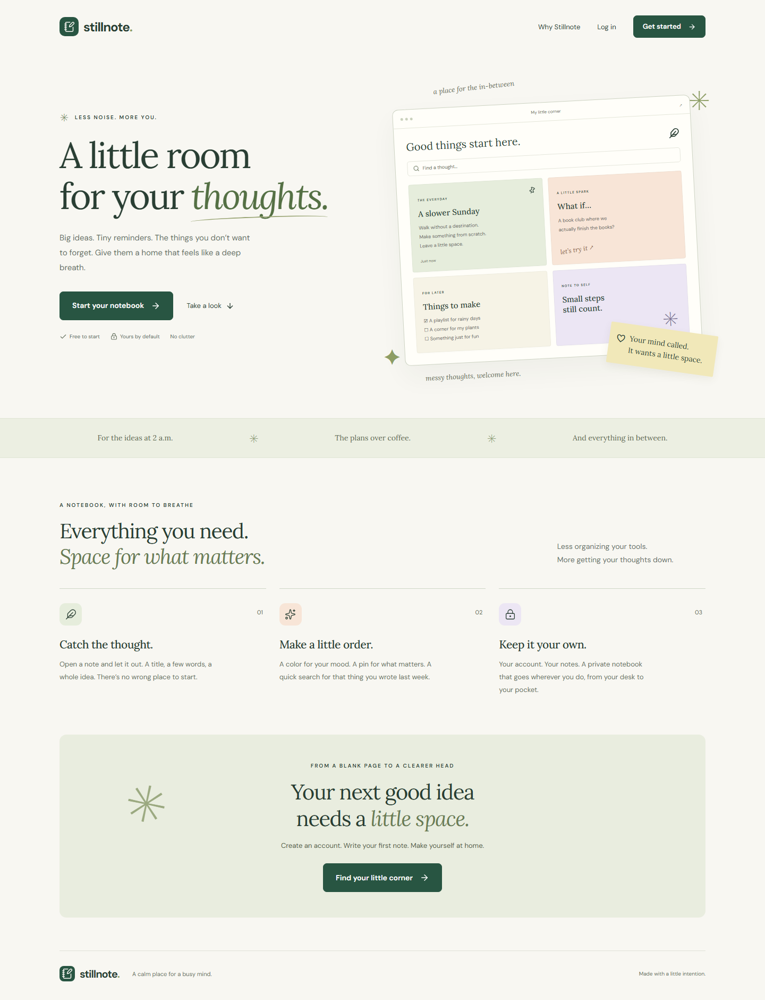

# Stillnote

**A little room for your thoughts.** A responsive full-stack notes app for the USM Computer Science Society technical evaluation.

Built by **Tiun Chin Fa**. Developed with AI assistance; implementation and verification details are documented below.



## Evaluation coverage

| Level | Implementation                                                                                                   |
| ----- | ---------------------------------------------------------------------------------------------------------------- |
| 1     | Public promotional landing page with a custom illustrated notebook, product benefits, and signup calls to action |
| 2     | Email/password registration and login, verified Supabase session, protected dashboard, logout                    |
| 3     | Create durable notes with a required title and content                                                           |
| 4     | PostgreSQL row-level security restricts every operation to the authenticated owner                               |
| 5     | Edit and permanently delete your own notes, with confirmation and conflict detection                             |

Additional features: full-text client-side search, pinned notes, five color collections, sorting, word count, loading/empty/error states, connection feedback, unsaved-change protection, keyboard-accessible native dialogs, reduced-motion support, and desktop/mobile layouts.

The evaluation text mentions “bookmarks” once in the database criterion; this implementation follows the repeated **notes app** requirement and persists notes.

## Stack and architecture

- **React + TypeScript + Vite**: a small client application, typed data and reusable components.
- **Handwritten CSS**: responsive paper-and-sage design without an unnecessary UI framework.
- **Supabase Auth**: password hashing, sessions, refresh tokens, and authenticated identities.
- **Supabase PostgreSQL + PostgREST**: persistent backend and API, protected by RLS.
- **Vercel**: static frontend hosting; Supabase is the actual backend, not localStorage.
- **Vitest, Playwright, axe-core**: logic, browser flows, mobile layout, and automated accessibility checks.
- **Locally bundled DM Sans and Lora fonts**: no external font requests.

The browser calls the Supabase API with a **publishable** key and the signed-in user's token. PostgreSQL checks `auth.uid() = user_id` independently of the UI. There is no administrative key in the frontend, repository, or deployment.

## Run locally

Requires Node.js **24 LTS** (minimum 22.12).

```sh
npm ci
```

Copy `.env.example` to `.env.local`, then set:

```dotenv
VITE_SUPABASE_URL=https://YOUR_PROJECT.supabase.co
VITE_SUPABASE_PUBLISHABLE_KEY=YOUR_PUBLISHABLE_KEY
```

```sh
npm run dev
```

Open the local URL printed by Vite. `.env.local` is ignored by Git. Use only a publishable key here, **never** a service-role key.

## Database setup

Create a dedicated Supabase project and run [`db/schema.sql`](db/schema.sql) once in its SQL editor. The matching migration is also checked into `supabase/migrations/` for CLI-managed environments. Apply **one** of these paths, not both.

The `notes` table contains UUID identity, owner, title, content, color, pinned state, and database-managed timestamps. Ownership references `auth.users`; deleting an account cascades its notes.

Security is enforced in several layers:

1. RLS is enabled and forced. SELECT, INSERT, UPDATE and DELETE each have an owner policy.
2. UPDATE has both `USING` and `WITH CHECK`.
3. Guests have no table privileges. Authenticated users can write only the intended columns.
4. `user_id`, `id`, and timestamps cannot be changed by a client update.
5. Database constraints reject blank text, titles over 120 characters, content over 20,000 characters, and invalid colors.
6. A `SECURITY INVOKER` trigger manages `updated_at` with an empty search path.
7. Update and delete include the last-seen timestamp, preventing silent overwrites of concurrent edits.
8. Note content is rendered as React text, never injected as HTML.

List reads are paginated internally to avoid silently truncating at the API's default row limit. Search and sorting run on the loaded notebook. For a large production notebook, add cursor pagination and server-side search.

## Authentication and email configuration

Set the Supabase **Site URL** to the final deployment origin. Add these exact redirect URLs:

```text
https://YOUR_DEPLOYMENT/auth/callback
https://YOUR_DEPLOYMENT/reset-password
http://127.0.0.1:5173/auth/callback
http://127.0.0.1:5173/reset-password
```

Keep anonymous sign-ins disabled. Use a minimum password length of 8.

The code supports email confirmation and password recovery. For a production service, configure custom SMTP and keep email confirmation enabled. Supabase's built-in email sender only delivers to project-team addresses and is unsuitable for public signup/recovery. See [Supabase SMTP documentation](https://supabase.com/docs/guides/auth/auth-smtp).

The final evaluation-specific configuration and verified URLs are recorded in [`docs/submission.md`](docs/submission.md). Account data is stored by Supabase; “private” means access control, **not** end-to-end encryption.

## Tests

```sh
npm run build
npm test
npx playwright install chromium
npm run test:e2e
```

Default browser tests run desktop and mobile guest flows, route guards, signup navigation, password visibility, layout overflow, and WCAG A/AA automated checks. Live authenticated tests are deliberately opt-in:

```sh
# PowerShell
$env:E2E_LIVE = "1"
npm run test:rls
npm run test:e2e

# POSIX shell
E2E_LIVE=1 npm run test:rls
E2E_LIVE=1 npm run test:e2e
```

Use a disposable evaluation backend with email confirmation disabled for these tests. The live suite creates uniquely named `stillnote-e2e-*` / `stillnote-rls-*` accounts at `example.com`. It deletes its own test notes; test account rows remain for audit. Never run against unrelated production projects. The RLS script can instead use verified test accounts supplied through `RLS_ALICE_EMAIL`, `RLS_ALICE_PASSWORD`, `RLS_BOB_EMAIL`, and `RLS_BOB_PASSWORD`; keep these out of Git.

The RLS script tests the **real public HTTP API** with two independent sessions, including forged ownership and cross-user read/update/delete attempts. [`db/rls-tests.sql`](db/rls-tests.sql) is an additional transaction-only database test: it rolls back every fixture.

To test a deployment, set `E2E_BASE_URL` to its public URL. Screenshots are saved in `output/playwright/`. GitHub Actions runs builds, unit tests, and public browser checks without privileged secrets.

## Deploy

1. Import this public GitHub fork into **Vercel**.
2. Choose Vite, `npm run build`, output `dist`, Node.js 24.
3. Add the two public environment variables above for Production.
4. Deploy from the repository's `main` branch.
5. Configure the final auth redirect URLs in Supabase.
6. Compare `/version.json` on the deployed site with `git rev-parse HEAD`. The build embeds the full Vercel Git commit SHA.
7. Run the live browser and RLS tests.

`vercel.json` supplies SPA routing and security headers. `netlify.toml` supplies the equivalent basic Netlify routing. All source dependencies are pinned in `package-lock.json`; use `npm ci` for reproducible installation.

## Project structure

```text
src/
  components/    Auth provider, brand, accessible note editor
  lib/           Supabase client, notes API, validation and tests
  pages/         Landing, auth forms, dashboard
  styles.css     Responsive design system and layouts
db/              Canonical schema and transactional RLS checks
supabase/        Versioned schema migration
tests/           Desktop/mobile Playwright tests
scripts/         Real API authorization test
docs/            Submission and verification notes
```

## Task 3

The upstream README says: “Fork this repository, make any changes and submit a pull request. Simple.”

This project is developed in the public fork of [`CS-Society-USM/tech-evaluation-zynax`](https://github.com/CS-Society-USM/tech-evaluation-zynax). The final submission links, pull request and validation results are recorded in `docs/submission.md`.

## Credits and limits

- Lucide icons; DM Sans and Lora via Fontsource (SIL Open Font License).
- Marketing note illustrations are original HTML/CSS, not real user data.
- No analytics, advertising, AI processing of notes, or public sharing.
- Deletion is permanent after confirmation. No trash, collaboration, attachments or offline sync.
- Keep a draft open while reconnecting; drafts are intentionally not persisted to shared-device storage.
- Automated accessibility checks do not replace assistive-technology user testing.
- Free hosted services have quotas and may pause after inactivity.
