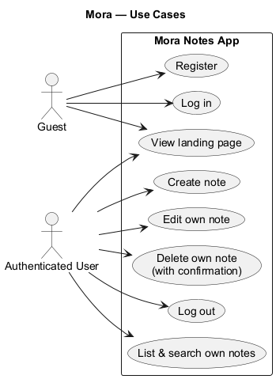
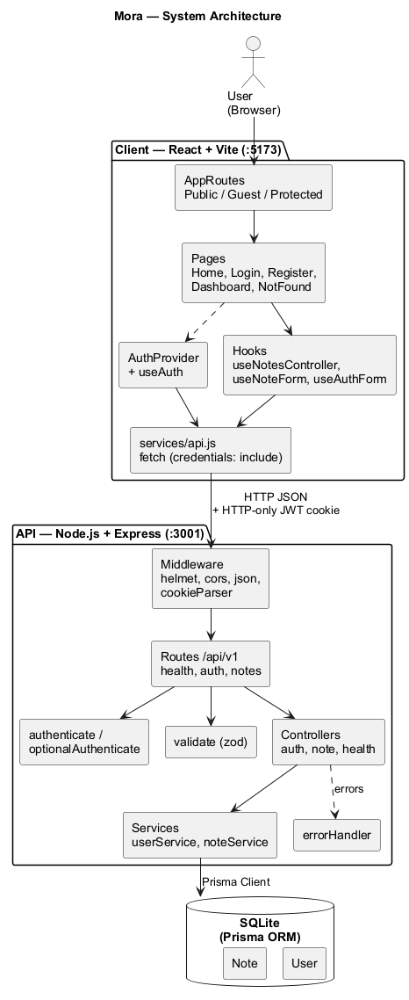
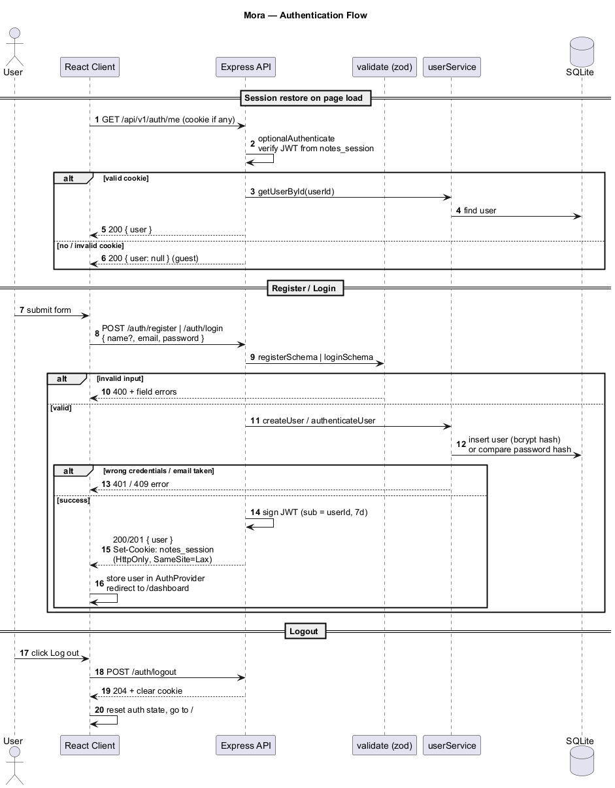
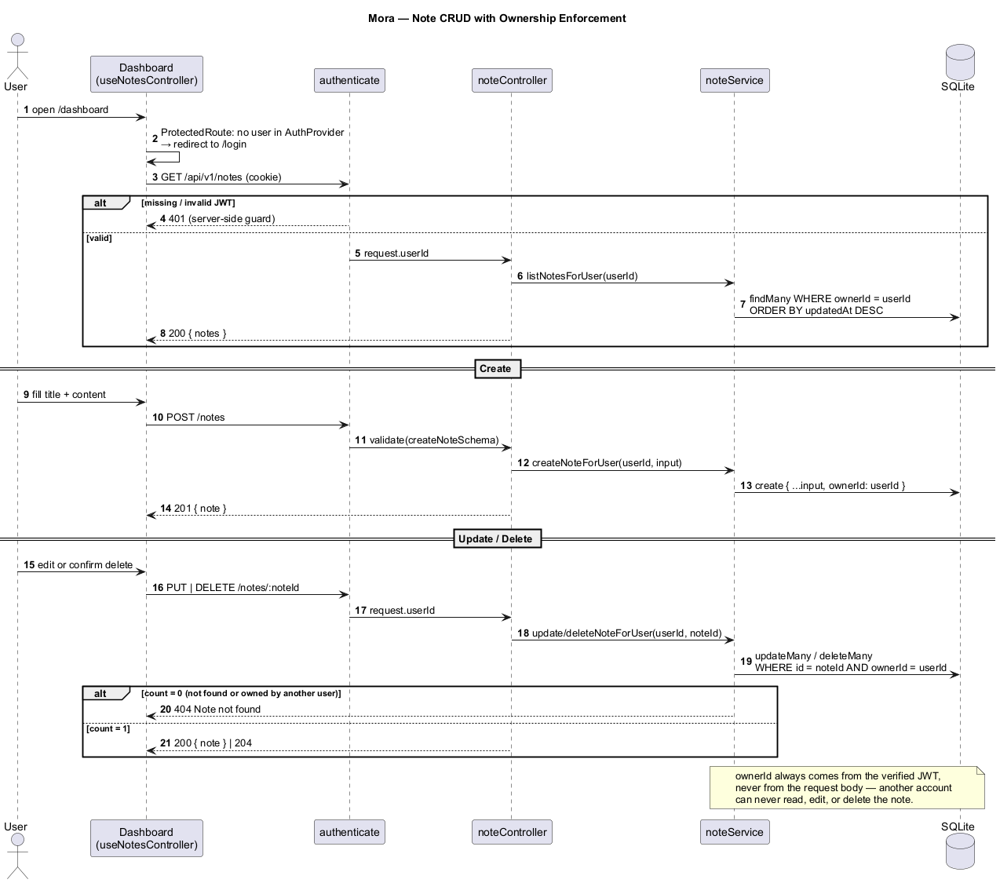

# Diagrams

PlantUML sources (`.puml`) and rendered images (`.png`) describing how Mora works. Regenerate the images with:

```bash
java -jar plantuml.jar -tpng docs/diagrams/*.puml
```

## Use cases

What guests and authenticated users can do.



## System architecture

React client, Express API layers, and the SQLite database accessed through Prisma.



## Database schema

Each user owns many notes; deleting a user cascades to their notes.


## Authentication flow

Session restore via `/auth/me`, register/login with a signed JWT in an HTTP-only cookie, and logout.



## Note CRUD and ownership

Every note query is scoped by the `ownerId` taken from the verified JWT, so other accounts receive `404`.


